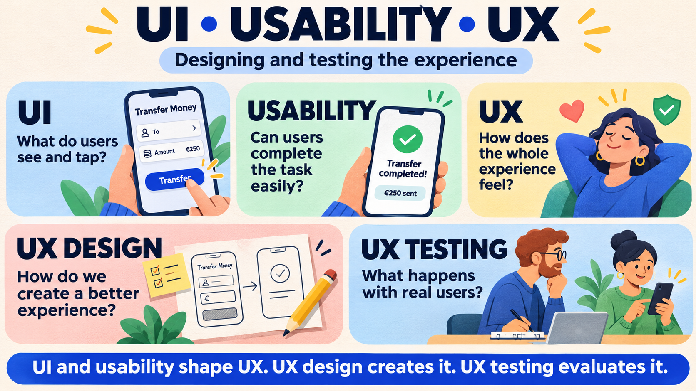
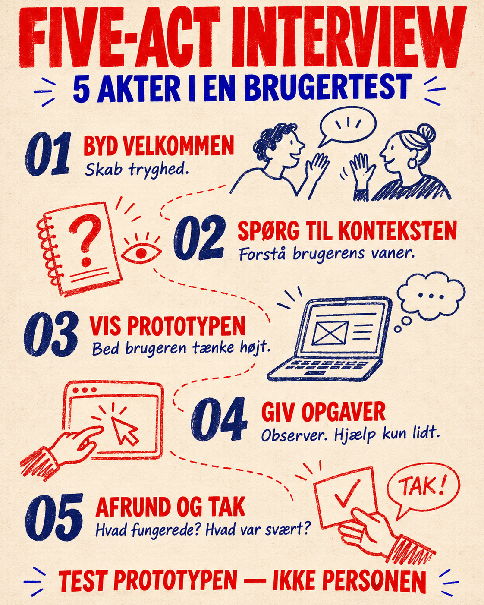
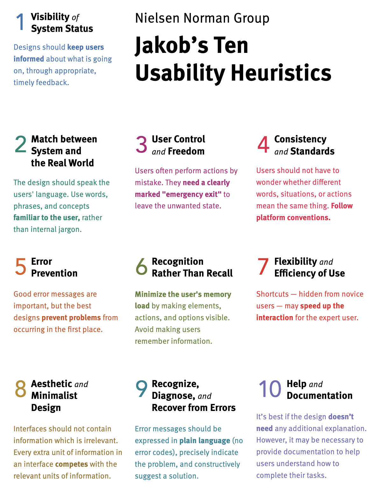

# Usability test

## Beskrivelse

Dagens program er at vi gennemgår og diskuterer hvorfor man laver usability testing, og hvordan det rent praktisk gøres.   I skal derefter selv prøve at lave en usability test.

[https://www.nngroup.com/articles/ten-usability-heuristics/](https://www.nngroup.com/articles/ten-usability-heuristics/)

Jeg skal gå fra 9:30 - 10. Så vi tager pause kl 9:45 - 10:00 idag :) 

## Forberedelse

Læs om usability testing [her](https://www.nngroup.com/articles/usability-testing-101/)

Se video om usability testing (2 min) [her](https://www.youtube.com/watch?v=n8MnoJyl3W4)

Læs om tænke-højt-test [her](https://www.nngroup.com/articles/thinking-aloud-the-1-usability-tool/)

## Læringsmål

- at kunne udføre en usability test med tænke-højt-metoden

## Indhold

*AI genereret*

Tænkehøj testen

- Tænk over målgruppen
- Lav nogle vigtige opgaver testpersonen skal gå igennem
- Når testen går igang:
  - Introducer testen og hvordan det kommer til at foregå

https://www.parallelhq.com/blog/five-act-interview-user-tests-design-sprint

*AI genereret*

## Aktiviteter

[Opgave 1](opgave_lav_usability_test.md)

